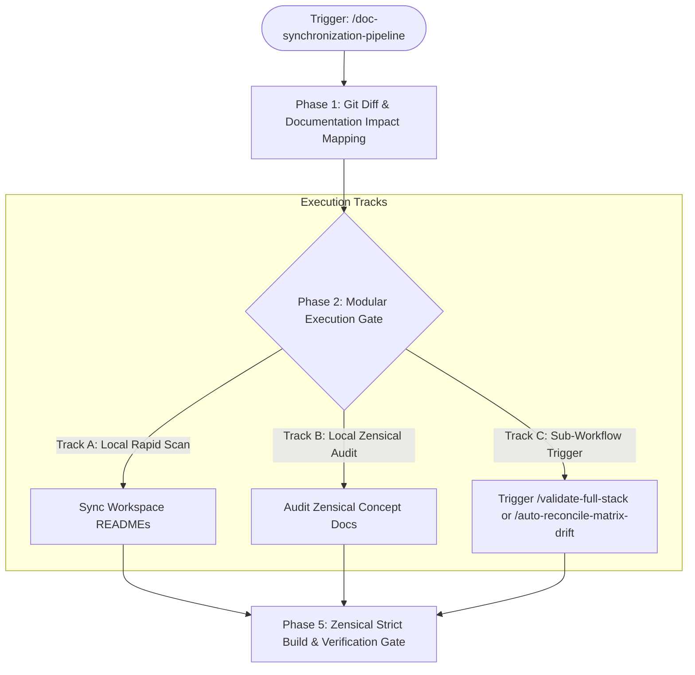

# Documentation & README Synchronization Pipeline

A comprehensive, modular pipeline designed to eliminate documentation drift across the repository following multi-module code, schema, or algorithmic refactors. It inspects all workspace README files, audits Zensical concept documentation (`docs/`), and validates OKF invariants.

---

## Trigger

* **Slash Command:** `/doc-synchronization-pipeline`
* **Direct Triggers:**
  * After major feature additions or vertical slice merges.
  * When modifying schemas (`src/phids/api/schemas/`) or engine systems (`src/phids/engine/systems/`).
  * Prior to tagging a new release.

---

## Architectural Sequence



---

## Phase 1: Git Diff & Documentation Impact Mapping

1. **Inspect Modified Files:**
   Identify modified code files relative to HEAD or develop:
   ```bash
   git status --short
   git diff --name-only origin/develop...HEAD
   ```

2. **Categorize Impact:**
   * **Domain READMEs:** `src/phids/README.md`, `scripts/README.md`, `docs/README.md`.
   * **Scientific Models:** `docs/scientific_model/**/*.md`.
   * **Architecture Guides:** `docs/architecture/**/*.md`.

---

## Phase 2: Execution Tracks

### Track A: Workspace README Synchronization
* Audit each domain README against actual package structure and entry points.
* Verify command snippets use `uv run` or `just`.

### Track B: Zensical Concept Docs Audit
* Validate mathematical formulas against implemented kernels in `src/phids/engine/systems/`.
* Verify Data-Flow Matrix tables have 100% numerical parity with Pytest traces.

### Track C: Automated Parity and Coverage Checks
* Run `uv run python scripts/audit_matrix_coverage.py`.
* Run `uv run python scripts/verify_matrix_trace_parity.py --all`.

---

## Phase 3: Zensical Build & Verification Gate

Run static documentation compiler:
```bash
uv run zensical build -f zensical.toml
uv run python scripts/validate_okf.py
```
Ensure zero broken links, syntax warnings, or missing frontmatter fields.
